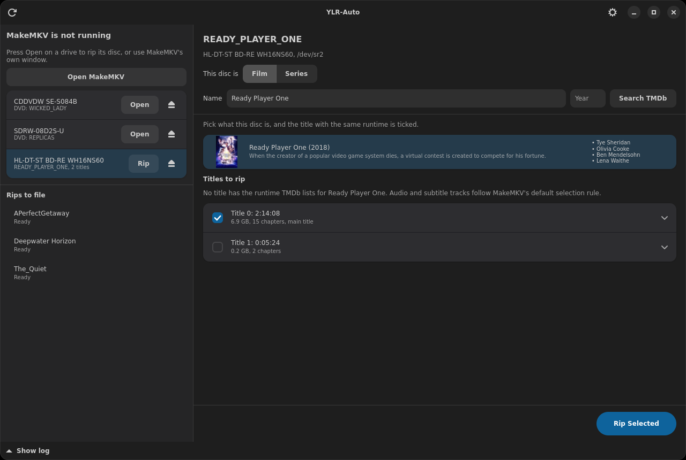
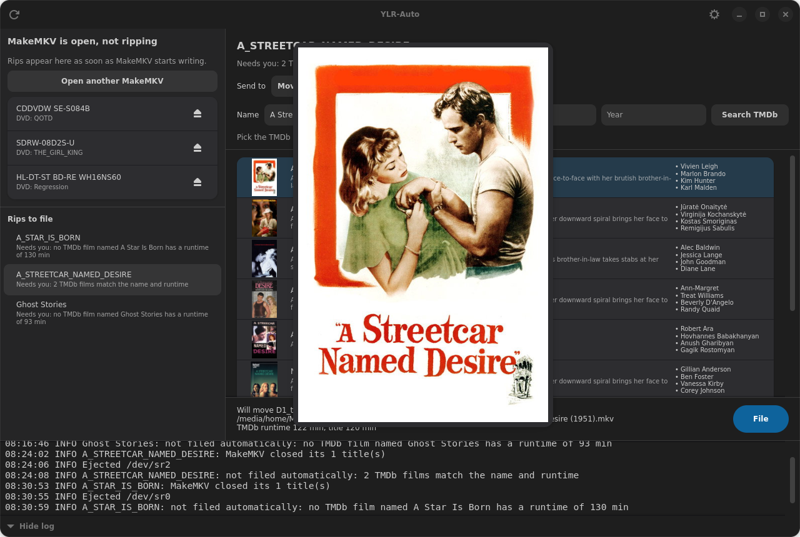
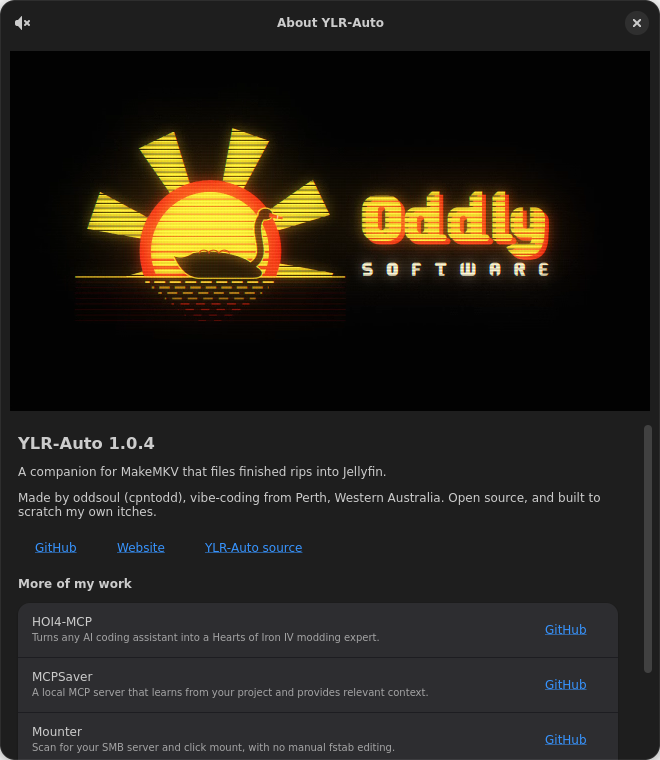

# YLR-Auto

A desktop app for ripping discs with [MakeMKV](https://www.makemkv.com/) on Linux. It
rips from each optical drive, or watches rips you start in MakeMKV's own window, then
files finished rips into [Jellyfin](https://jellyfin.org/) libraries, with names and
posters from [TMDb](https://www.themoviedb.org/).

YLR-Auto rips by running `makemkvcon`, the command-line program included with MakeMKV.
MakeMKV is a separate program that you install yourself. This project is not affiliated
with MakeMKV, Jellyfin or TMDb.

## Install

Download a package from the [releases page](https://github.com/cpntodd/YLR-Auto/releases).

**Debian 13, Ubuntu 24.04 or newer (.deb)**

    sudo apt install ./ylr-auto_2.0.0_amd64.deb

Ubuntu 24.04 meets the package's version requirements, but has not been tested.

**Other x86-64 distributions (AppImage)**

    chmod +x YLR-Auto-2.0.0-x86_64.AppImage
    ./YLR-Auto-2.0.0-x86_64.AppImage

The AppImage bundles GTK, libadwaita and its own C library, so it needs nothing else
installed. It has been tested only on Debian 13, and uses software rendering. From 2.0.0
it carries update information, so
[AppImageUpdate](https://github.com/AppImageCommunity/AppImageUpdate) can update it.

**From source**

    sudo apt install cargo libadwaita-1-dev
    cargo run --release -p ylr-auto

Install MakeMKV from its
[Linux install guide](https://forum.makemkv.com/forum/viewtopic.php?t=224).

## Set up

1. In YLR-Auto, open the gear menu and add a TMDb API key (a free v3 key or v4 read
   access token from themoviedb.org), then set your rip folder and library folders.
2. If you also rip from MakeMKV's own window, open its **Preferences, General, Default
   destination** and choose **Semi-Auto**, so each disc rips into its own folder. A
   banner in YLR-Auto offers to use MakeMKV's folder if the two differ.

The key and settings are saved in `~/.config/littlerippa-autosort/config.json`,
readable by you only. The `TMDB_API_KEY` environment variable overrides the saved
key. A library folder that does not exist is created only when its parent exists,
so nothing is written while a network share is unmounted.

## Ripping a disc

Each drive in the left column shows its disc, with **Open** and Eject buttons. This is
how a new install behaves; [Ripping settings](#ripping-settings) offers other ways.

1. **Open** scans the disc and shows its page on the right. Clicking a drive also shows
   its page, and the right pane only ever changes when you click.
2. **Find the film or series.** The label is searched on TMDb, with posters and main
   actors beside each result. Click the right one, or edit the name or year and search
   again. Choosing **Series** searches for shows instead.
3. **Tick the titles to rip.** The main title starts ticked if it is at least twice as
   long as every other title. Clicking a film ticks the title with its TMDb runtime, if
   one is that long. Expand a title to see its tracks.

   PAL discs usually run about 4% short of the runtime TMDb lists, so no title may match.
   The ticks then stay as they were, and such a rip waits for you instead of being filed
   automatically.
4. **Rip Selected**, or **Rip** on the drive's row. Each rip has its own progress bar,
   percentage and time left, and all your drives can rip at once.

Finished rips go to a new folder named after the disc, in the rip folder, then on to
[automatic filing](#automatic-filing) or **Rips to file**. **Eject the disc when a rip
finishes** in Settings ejects it, which a dialog in MakeMKV's window would prevent.

**Stop** asks first, then removes the unfinished title. Titles already finished stay and
wait for you. If a rip fails, the row gives the reason and **Retry**, and the disc stays
in the drive. Quitting while a drive is busy asks first, then stops it.

## Ripping settings

**Settings, Ripping** holds the defaults for every drive, and **Drive settings** on a
drive's page overrides any of them for that drive.

| Setting | Choices |
|---|---|
| Drive button | Open the disc and choose; rip the main title if obvious, otherwise choose; rip every title over the minimum length; choose from a menu on each press, which remembers the last choice |
| When a disc is inserted | Do nothing; scan it, then wait; rip it |
| Title list | Expand each title to see its tracks; compact; detailed, with every title's tracks shown |
| Progress in the drive's row | Bar, percentage and time left; also title and speed; bars for the title and the disc; bar and percentage |
| Drive status | Text and accent colours; coloured label; icon; tinted row |
| Stop button | Confirm and remove the unfinished title; confirm and keep it; stop at once and remove it; ask each time |
| Where rips go | The rip folder or the drive's own folder, each named from the disc or with a name you can edit |
| When a rip fails | Stop and keep the disc in; try once more, then stop; eject and carry on |

**Presets** set the drive button, inserted discs, Stop and failures together:

| Preset | Behaviour |
|---|---|
| Cautious, the default | Nothing starts until you open a disc and press **Rip** |
| Hands-off | Inserting a disc rips its main title if one stands out, and a failed disc is ejected, for feeding discs through |
| Always ask | Discs are scanned when inserted, and every choice is yours |

Discs already in a drive when YLR-Auto starts do not count as inserted. The right pane
never changes for an inserted disc, so filing is not interrupted.

An unattended rip does not wait for a TMDb pick, and
filing then follows [Automatic filing](#automatic-filing) as usual. A drive's own folder
outside the rip folder is not listed under **Rips to file**, so its rips are filed by hand.

**Settings, Ripping** also sets the shortest title to consider, and which alerts to give:
a rip finishing, a scan or rip failing, and a disc needing you, each with an optional
sound. Sound uses the freedesktop theme's files through `pw-play`, `paplay` or `ogg123`,
and falls back to the system beep.

**Drive settings** can also name a drive, in place of its model. Names and overrides are
saved under the drive's serial number, so they survive `/dev/srN` changing. **Recent rips**
lists the last 20 results for that drive, which helps to spot one that is failing.

Audio and subtitle tracks follow the default selection rule in **Preferences, Advanced**
in MakeMKV's window, because no `makemkvcon` option for choosing tracks in one rip was
found. Rip from MakeMKV's window if you need to choose them.

## Using MakeMKV's window

**Open MakeMKV** is always available, for discs that need it, and YLR-Auto still watches
what it does. The left column shows each rip's title, data written, speed and time
elapsed. **Open** is disabled on a drive a MakeMKV window holds, until you close that
disc or window. MakeMKV's single-drive mode runs one instance per drive.

If ejecting after a rip is on, YLR-Auto keeps trying for ten minutes while a dialog in
MakeMKV's window holds the disc. A disc still open in that window after the dialog has to
be closed there.

MakeMKV offers no progress interface to other programs, so this is read from `/proc` and
udev. MakeMKV only shows a percentage in its window title while minimised, so for these
rips the percentage and time left appear only then, and only on X11.

## Running in the tray

The first start adds YLR-Auto to login startup, which you can turn off in Settings.
Closing the window keeps it running from the tray, rips included; use the tray menu to
quit. While ripping, the tray icon's tooltip shows each rip's percentage when one is
known. The tray menu also lists each drive's next action, such as Open, Rip or Stop, and
anything needing a choice brings the window up. Without a tray, closing the window quits. Cinnamon shows the icon through
`xapp-sn-watcher`, and GNOME needs an AppIndicator extension.

## Automatic filing

When a rip that YLR-Auto ran or saw being written finishes, a film is filed with no
action from you only if all of these hold:

- the disc label does not look like a series;
- no other title is at least 80% as long as the longest title;
- exactly one TMDb film has the label's exact name and the rip's runtime;
- the library has no copy of that film in any recognised form.

If you clicked a film on the disc's page before ripping, that film replaces the search
by name and the label is not considered, but its runtime must still match the rip and the
other checks still apply. A rip you picked as a series always waits for you, and the
filing page opens with your pick already chosen.

Anything else stays listed as **Needs you**, with the reason, and a notification
opens it. Rips already in the folder are never filed automatically. MakeMKV writes a
title's runtime only when it finishes the title, so a cancelled or crashed rip has
none, and is neither filed nor ejected. Unattended filing never deletes anything,
and moves are recorded in `~/.local/state/littlerippa-autosort/autosort.log`.

There is no undo, so a wrong automatic match has to be moved back by hand. Turn
automatic filing off in Settings if you prefer to file everything yourself.

## Filing a rip by hand

The list refreshes every 30 seconds and whenever a rip starts or finishes, and shows
every folder under the rip folder that holds `.mkv` files, including hand-made
layouts such as `Angel/S1/D3`. A rip seen finishing is **Ready** at once. Any other
folder is **Ready** once no file is open and nothing has changed for 2 minutes.

Select a rip, then:

1. **Send to**: the library, matching Jellyfin's content types.

   | Destination | Layout | TMDb |
   |---|---|---|
   | Movies | film | yes |
   | Shows | series | yes |
   | Mixed Films and Programmes | film or series | yes |
   | Music Videos | film | no, named as typed |
   | Home Videos | film | no, named as typed |
   | Manual | film or series, into a folder you choose | yes |

   Labels such as `ANGEL_S1_D2` or `Angel/S1` default to Shows, season 1.
2. **Name**: guessed from the disc label. Search TMDb and pick the match, using the
   poster and main actors beside each result, or edit the name to use it as typed. Rest
   the pointer on a poster for 2 seconds to see it large. Posters are cached
   in `~/.cache/littlerippa-autosort/posters`, which **Settings, Cache** can clear.

   

3. **Titles**: in film layout the largest title is ticked as the main feature. In
   series layout the episode-length titles are ticked and numbered in disc order,
   starting after the highest episode already in the season folder, so disc 2 carries
   on from disc 1. Edit the numbers if the disc order is wrong.
4. **File**: the line beside the button, which stays in view below the results, shows
   exactly where each file will go.

Titles left behind (extras, "play all") stay in the rip folder, which is marked with
`.autosort-done` and no longer listed.

## Naming

Film layout:

    Movies/Ghost (1990)/Ghost (1990).mkv

Series layout:

    TV Shows/Angel (1999)/Season 02/Angel (1999) - S02E01 - Judgment.mkv

**Settings, Naming, TMDb ID tag** can add a `[tmdbid-N]` tag when a TMDb match is
picked, which makes Jellyfin use that exact entry instead of matching on the name and
year:

| TMDb ID tag | Film layout |
|---|---|
| None (default) | `Ghost (1990)/Ghost (1990).mkv` |
| Folder | `Ghost (1990) [tmdbid-251]/Ghost (1990).mkv` |
| Folder and file | `Ghost (1990) [tmdbid-251]/Ghost (1990) [tmdbid-251].mkv` |

For a series, either tagged choice tags the show folder only. Changing the setting
does not rename files already in a library. An existing show folder is reused even if it is named
differently (`IT Crowd` for "The IT Crowd"), and so is an existing `Season 1` folder,
so a show is never split in two. A show folder with a different year is treated as a
different show. Characters Jellyfin and SMB reserve
(`< > : " / \ | ? *`) are removed.

Jellyfin discourages the Mixed library type because its metadata matching is
unreliable. Prefer a Movies-type and a Shows-type library.

## Duplicates when filing by hand

Movies: if the library already has the movie, as `Name (Year)` with or without a
`[tmdbid-N]` tag on the folder or file, or as the older `Name`, the runtimes are
compared. A folder tagged with a different TMDb ID is a different film.

- **Same runtime** (within 1 minute, or 1% for long films): the rip is a duplicate and
  is deleted.
- **Different or unreadable runtime** under the same name and year: nothing is deleted
  and the rip is kept for you to sort out.
- **Different runtime** where only a yearless `Name` copy exists: it is a different film
  (a remake) and is filed under its own year.

Episodes: an episode number that already exists in the season folder is skipped and left
in the rip folder, never deleted, because episodes of one show share a runtime.

The library copy is never touched.

## About

**Settings, About** opens a window that plays the Oddly Software logo with sound once.
Click the logo to play it again, or use the button at the top left to mute it.

## Test results

### Ripping through `makemkvcon`, 2.0.0

Checked on Debian 13 with MakeMKV 2.0.0, a Blu-ray drive and two DVD drives, using three
DVDs.

| Check | Result |
|---|---|
| Scanning three discs at once | worked, in 10, 19 and 79 seconds |
| Ripping from three drives at once | worked; two full films in about 13 minutes each |
| Eject straight after each rip | worked on all three |
| Runtime of each rip against the scan | within 7 seconds |
| Stopping a rip | `makemkvcon` exited in 3 seconds, leaving a file with no runtime |
| Open, choose titles, rip and stop in the window, by hand | passes |
| Unit and integration tests | 172 of 172 pass |

The settings, row styles, retry and history were run through the window only with a
stand-in for `makemkvcon`, which played back recorded output and a simulated read error.

Not tested: a real read error or an expired MakeMKV key, whose messages come from MakeMKV
itself, a Blu-ray disc or a series disc through **Open**, the alert sounds and tray menu on
real desktops, and `makemkvcon` on another desktop or distribution.

### Rust against the last Python version

Results for 1.1.0, the first Rust version, on Debian 13 with an AMD Ryzen 5 2600.

| Measure | Python 1.0.4 | Rust 1.1.0 | Change |
|---|---|---|---|
| Start to main window mapped (median) | 254 ms | 127 ms | 50% less |
| Middle half of those runs | 244 to 264 ms | 124 to 130 ms | |
| `--version`, from the source or binary | 200 ms | 29 ms | 85% less |
| `--version`, from the packed AppImage | 900 ms | 159 ms | 82% less |
| Memory when idle, including Python's tray helper | 113 MB | 48 MB | 58% less |
| AppImage size | 60.4 MB | 48.4 MB | 20% less |

Window and source `--version` times are 40 alternating runs of each version, and AppImage
times are 20 runs each. Files were already in the page cache, so a first start after a
reboot takes longer. The window ran on a headless GTK display with software rendering, its
own session bus and the same dark theme in both, while three real MakeMKV rips loaded the
machine. Times on a desktop
will differ, but both versions were measured the same way.

#### Behaviour

| Check | Result |
|---|---|
| Rust unit and integration tests | 105 of 105 pass |
| Tests carried over from the Python version | all 82 have a Rust counterpart |
| Same random inputs through both versions, with results and file trees compared | 574,173 cases, 0 differences |
| Deliberate bugs planted to test that comparison | 6 of 6 caught |
| GUI run: filing a film and a series by hand, and a film automatically | passes |
| Read-only comparison against live rips, drives and MakeMKV settings | identical |
| Packed AppImage with no network and the C locale | starts and stays running |
| Packed AppImage on X11 | shows its main window |

The comparison also found one intended difference. A corrupt MKV header could make Python
run out of memory, which happened with about 2% of the corrupted files tried, and Rust
reads it as an unknown runtime. Python's crash cases were left out of the count above.

The Python version and its comparison tools were removed in 1.1.0, so these two tables can
only be reproduced from the commit before that removal.

#### Not tested

- The AppImage on the oldest supported Ubuntu LTS, which the AppImage catalog's own test
  checks. It carries its own C library for this reason.
- The `.deb` on Ubuntu 24.04, whose versions meet its dependencies.
- The tray icon on desktops other than Cinnamon.

## Build and test

See [CONTRIBUTING.md](CONTRIBUTING.md).

## Licence

[MIT](LICENSE).

This product uses the TMDb API but is not endorsed or certified by TMDb.
