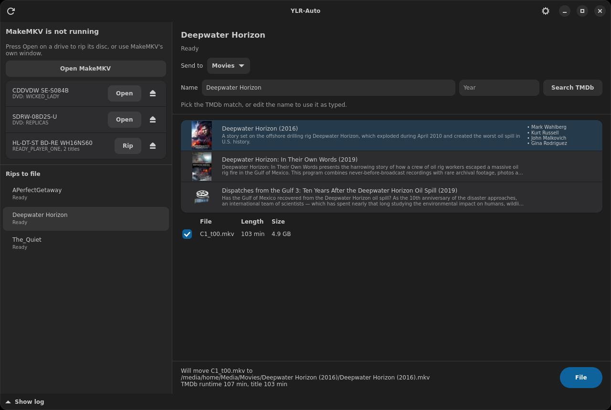

# YLR-Auto

A desktop companion for [MakeMKV](https://www.makemkv.com/) on Linux. It shows
what MakeMKV and your optical drives are doing, then files finished rips into
[Jellyfin](https://jellyfin.org/) libraries, with names and posters from
[TMDb](https://www.themoviedb.org/).

YLR-Auto watches MakeMKV from the outside and does not control it. MakeMKV is a
separate program that you install yourself. This project is not affiliated with
MakeMKV, Jellyfin or TMDb.

## Install

Download a package from the [releases page](https://github.com/cpntodd/YLR-Auto/releases).

**Debian 13, Ubuntu 24.04 or newer (.deb)**

    sudo apt install ./ylr-auto_1.0.0_all.deb

Ubuntu 24.04 meets the package's version requirements, but has not been tested.

**Other x86-64 distributions (AppImage)**

    chmod +x YLR-Auto-1.0.0-x86_64.AppImage
    ./YLR-Auto-1.0.0-x86_64.AppImage

The AppImage bundles Python, GTK and libadwaita, so it needs nothing else
installed. It has been tested only on Debian 13, and uses software rendering.

**From source**

    sudo apt install python3-gi gir1.2-gtk-4.0 gir1.2-adw-1 gir1.2-xapp-1.0 gir1.2-gtk-3.0
    python3 littlerippa_autosort_gui.py

Install MakeMKV from its
[Linux install guide](https://forum.makemkv.com/forum/viewtopic.php?t=224).

## Set up

1. In MakeMKV, open **Preferences, General, Default destination** and choose
   **Semi-Auto**, so each disc rips into its own folder. A banner in YLR-Auto
   offers to use MakeMKV's folder if the two differ.
2. In YLR-Auto, open the gear menu and add a TMDb API key (a free v3 key or v4 read
   access token from themoviedb.org), then set your library folders.

The key and settings are saved in `~/.config/littlerippa-autosort/config.json`,
readable by you only. The `TMDB_API_KEY` environment variable overrides the saved
key. A library folder that does not exist is created only when its parent exists,
so nothing is written while a network share is unmounted.

## Monitoring

The left column shows whether MakeMKV is open or ripping. Each rip has its own
title, data written, speed and time elapsed. Each drive is listed with its disc
and an Eject button. **Open MakeMKV** is always available, because MakeMKV's
single-drive mode runs one instance per drive.

MakeMKV offers no progress interface to other programs, so this is read from
`/proc` and udev. MakeMKV only shows a percentage in its window title while
minimised, so the percentage and time left appear only then, and only on X11.

The first start adds YLR-Auto to login startup, which you can turn off in Settings.
Closing the window keeps it monitoring from the tray; use the tray menu to quit.
Without a tray (or `gir1.2-xapp-1.0`), closing the window quits.

## Automatic filing

When MakeMKV finishes a rip that YLR-Auto saw being written, a film is filed with
no action from you only if all of these hold:

- the disc label does not look like a series;
- no other title is at least 80% as long as the longest title;
- exactly one TMDb film has the label's exact name and the rip's runtime;
- the library has no copy of that film in any recognised form.

Anything else stays listed as **Needs you**, with the reason, and a notification
opens it. Rips already in the folder are never filed automatically. MakeMKV writes a
title's runtime only when it finishes the title, so a cancelled or crashed rip has
none, and is neither filed nor ejected. Unattended filing never deletes anything,
and moves are recorded in `~/.local/state/littlerippa-autosort/autosort.log`.

There is no undo, so a wrong automatic match has to be moved back by hand. Turn
automatic filing off in Settings if you prefer to file everything yourself.

## Filing a rip by hand

The list refreshes every 30 seconds and whenever a rip starts or finishes, and shows
every folder under the rip folder that holds `.mkv` files, including hand-made
layouts such as `Angel/S1/D3`. A rip seen finishing is **Ready** at once. Any other
folder is **Ready** once no file is open and nothing has changed for 2 minutes.

Select a rip, then:

1. **Send to**: the library, matching Jellyfin's content types.

   | Destination | Layout | TMDb |
   |---|---|---|
   | Movies | film | yes |
   | Shows | series | yes |
   | Mixed Films and Programmes | film or series | yes |
   | Music Videos | film | no, named as typed |
   | Home Videos | film | no, named as typed |
   | Manual | film or series, into a folder you choose | yes |

   Labels such as `ANGEL_S1_D2` or `Angel/S1` default to Shows, season 1.
2. **Name**: guessed from the disc label. Search TMDb and pick the match, using the
   poster beside each result, or edit the name to use it as typed. Posters are cached
   in `~/.cache/littlerippa-autosort/posters`.
3. **Titles**: in film layout the largest title is ticked as the main feature. In
   series layout the episode-length titles are ticked and numbered in disc order,
   starting after the highest episode already in the season folder, so disc 2 carries
   on from disc 1. Edit the numbers if the disc order is wrong.
4. **File**: the preview line shows exactly where each file will go.

Titles left behind (extras, "play all") stay in the rip folder, which is marked with
`.autosort-done` and no longer listed.

## Naming

Film layout:

    Movies/Ghost (1990) [tmdbid-251]/Ghost (1990) [tmdbid-251].mkv

Series layout:

    TV Shows/Angel (1999) [tmdbid-2426]/Season 02/Angel (1999) - S02E01 - Judgment.mkv

The `[tmdbid-N]` tag makes Jellyfin use that exact TMDb entry, and is only added when
a TMDb match is picked. An existing show folder is reused even if it is named
differently (`IT Crowd` for "The IT Crowd"), and so is an existing `Season 1` folder,
so a show is never split in two. Characters Jellyfin and SMB reserve
(`< > : " / \ | ? *`) are removed.

Jellyfin discourages the Mixed library type because its metadata matching is
unreliable. Prefer a Movies-type and a Shows-type library.

## Duplicates when filing by hand

Movies: if the library already has the movie, in any of the forms
`Name (Year) [tmdbid-N]`, `Name (Year)` or the older `Name`, the runtimes are
compared.

- **Same runtime** (within 1 minute, or 1% for long films): the rip is a duplicate and
  is deleted.
- **Different or unreadable runtime** under the same name and year: nothing is deleted
  and the rip is kept for you to sort out.
- **Different runtime** where only a yearless `Name` copy exists: it is a different film
  (a remake) and is filed under its own year.

Episodes: an episode number that already exists in the season folder is skipped and left
in the rip folder, never deleted, because episodes of one show share a runtime.

The library copy is never touched.

## Build and test

See [CONTRIBUTING.md](CONTRIBUTING.md).

## Licence

[MIT](LICENSE).

This product uses the TMDb API but is not endorsed or certified by TMDb.
